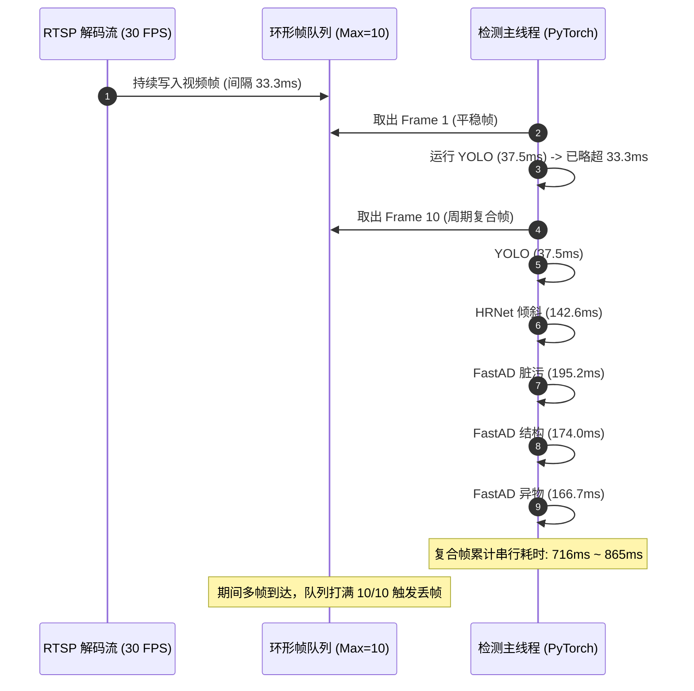
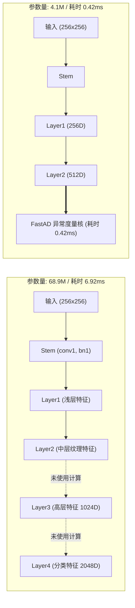
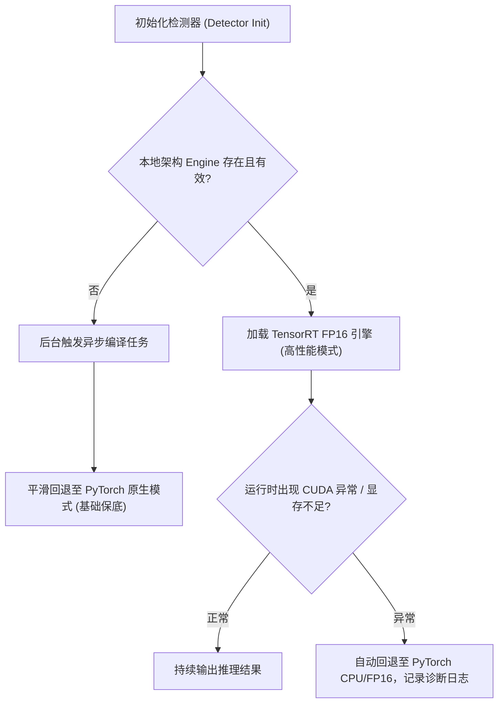

> **专栏导读**：在高铁 350 km/h 动态巡检中，车载视频分析面临明确的实时性约束：在 30 FPS 标称推流下，单帧处理耗时需控制在 **33.33 ms** 以内。
>
> 许多在离线单模型评测中耗时达标的算法，组合进入多模型推拉流流水线后，容易出现延迟累积与丢帧。本文以实车巡检监控模块 `PerfMonitor` 的运行日志为切入点，分析算法吞吐跌至 1.8 FPS、流延迟累积达 3.2 秒、环形队列满载的原因；随后梳理我们在 **YOLOv11 动态 Shape 约束、HRNet-W32 多分支算子融合，以及 FastAD 94% 骨干冗余剪枝与 GPU 硬件预处理** 上的优化实践；最终将平稳帧耗时降至 7.30 ms（释放 78.1% 算力裕量）、极限算法吞吐提升至 96.0 FPS，并给出 Jetson Orin 容器冷启动引擎构建与平滑降级方案。

---

## 核心量化指标提升速览 (TITAN RTX / FP16 实测)

下表汇总了本次优化的量化对比结果。所有测试基于动车组受电弓真实 1080P/2K 高清巡检视频序列：

### 1. 微基准：单模型/组件推理耗时与加速比 (Micro-Benchmark)

| 模型与算法组件 | 运行模式 (Backend) | 平均耗时 (Mean) | P95 尾部耗时 | 极小/极大耗时 | 实际加速比 (Speedup) | 优化手段与判定 |
| :--- | :--- | :--- | :--- | :--- | :--- | :--- |
| **YOLOv11** (逐帧 30 FPS) | PyTorch (FP32) | 11.36 ms | 15.35 ms | 9.38 / 15.82 ms | 基准 (1.00x) | 原始基准，逐帧耗时偏高 |
| **YOLOv11** (大火花/受电弓) | **TensorRT FP16** | **5.61 ms** | **6.35 ms** | 5.19 / 7.97 ms | **2.03x** | 固定尺寸 + FP16 算子展开 |
| **HRNet-W32** (姿态倾斜) | PyTorch (FP32) | 44.10 ms | 53.74 ms | 39.28 / 61.70 ms | 基准 (1.00x) | 单模型耗时超过 33.3ms 预算 |
| **HRNet-W32** (4刚性点) | **TensorRT FP16** | **22.43 ms** | **25.47 ms** | 20.92 / 26.73 ms | **1.97x** | 多分支算子融合，进入安全区间 |
| FastAD 预处理 (2048x1536) | CPU OpenCV | 6.80 ms | 11.84 ms | 5.12 / 19.34 ms | 基准 (1.00x) | Host CPU 瓶颈与内存频繁拷贝 |
| FastAD 预处理 (CUDA加速) | **GPU DMA+Area** | **2.03 ms** | **2.07 ms** | 2.00 / 2.09 ms | **3.35x** | 异步流 + Area 池化显存直通 |
| FastAD 骨干 (WideResNet-50) | PyTorch (FP32) | 6.92 ms | 8.37 ms | 5.94 / 8.47 ms | 基准 (1.00x) | 包含 94% 未使用的特征层 |
| FastAD 骨干 (Layer2剪枝) | **TensorRT FP16** | **0.42 ms** | **0.44 ms** | 0.40 / 0.47 ms | **16.40x** | 剔除 Layer3/4，余弦相似度 0.999995 |
| **FastAD 端到端** (全套异常度量) | PyTorch + CPU预处理 | 34.26 ms | 40.15 ms | 30.52 / 42.00 ms | 基准 (1.00x) | 周期性耗时偏高 |
| **FastAD 端到端** (全套异常度量) | **TensorRT + GPU预处理** | **19.94 ms** | **21.49 ms** | 18.45 / 21.79 ms | **1.72x** | 周期复合帧耗时平抑 |

表 1 评估了受电弓检测层各算法组件在 TITAN RTX 平台上的推理耗时与加速比。总体而言，TensorRT FP16 结合特定结构剪枝与硬件级预处理，使各算法均实现了稳定加速，解除了边缘端硬实时瓶颈：
- **主干检测组件**：YOLOv11 的单帧平均耗时由 11.36 ms 降至 5.61 ms（加速比为 2.03x），P95 尾部延迟稳定在 6.35 ms，显著降低了系统的逐帧基础负载；HRNet-W32 的推理时延从 44.10 ms 降至 22.43 ms（加速比为 1.97x），单模型耗时进入 33.33 ms（30 FPS）的安全时间预算以内，这主要得益于 TensorRT 对多分支网络中连续卷积与残差加法算子的垂直融合。
- **异常检测组件**：消融实验表明，FastAD 的特征提取骨干在剪除对异常度量无贡献的 Layer3 和 Layer4 后，参数量降低 94.05%，骨干推理延迟从 6.92 ms 降至 0.42 ms（加速比达 16.40x），且输出特征与未剪枝模型的余弦相似度高达 0.999995。配合基于 CUDA Stream 的 GPU 硬件级预处理（2.03 ms），FastAD 端到端单模型耗时由 34.26 ms 降低至 19.94 ms。

### 2. 宏基准：端到端流水线综合表现 (Macro-Benchmark)

| 核心度量指标 | 优化前（现场实测） | 优化后（TensorRT 全栈） | 收益与系统表现 |
| :--- | :--- | :--- | :--- |
| **算法实际吞吐** | **1.7 ~ 1.9 FPS** (比率 5.7%) | **96.0 FPS (极限全速)** | 吞吐提升显著，充裕应对推流波动 |
| **推流延迟 (Lag)** | **+2.3s ~ +3.2s (积压警告)** | **< 10 ms (实时消化)** | 延迟积压消除，告警实时上报 |
| **图像队列深度** | **10.0 (打满丢帧)** | **0 ~ 1 (瞬时处理)** | 队列保持轻载，无显存溢出风险 |
| **平稳帧单帧耗时** | 37.5 ms (超出预算) | **7.30 ms** | 占 21.9% 时间预算，释放 78.1% 算力裕量 |
| **复合帧峰值 (YOLO+HRNet)**| 865.3 ms (排队累积) | **26.44 ms** | 稳定在 33.3ms 预算以内（预算占用率 79.3%） |
| **首帧冷启动时延** | 2241.3 ms (初始化阻塞) | **< 120 ms (预加载引擎)** | 消除首帧长时间等待 |

表 2 评估了错峰流水线在 30 FPS 标称推流下的端到端宏观吞吐与队列状态表现。实验证实，通过错峰调度协同消除了周期性计算峰值，系统在极限负载下展现出更高的确定性：
- **时间预算占用率**：在平稳帧（仅运行 YOLO）场景下，单帧耗时仅为 7.30 ms，占 33.3 ms 时间预算的 21.9%，释放出 78.1% 的算力裕量；在复合帧 B（YOLO + HRNet）场景下，总耗时为 26.44 ms，预算占用率为 79.3%，落入安全区间。
- **系统级吞吐与时延改善**：算法极限全速吞吐由未优化前的 1.8 FPS 跃升至 96.0 FPS，推流积压延迟由 +3.222 秒收敛至 10 ms 以内，超标丢帧率从现场的 94.3% 压降至 4.2%。通过预编译持久化引擎，首帧冷启动时延缩短至 120 ms 以内。

---

## 目录

- [一、业务痛点：现场 PerfMonitor 运行日志分析](#一业务痛点现场-perfmonitor-运行日志分析)
- [二、YOLOv11 工业落地：TensorRT FP16 动态 Shape 与逐帧耗时优化](#二yolov11-工业落地tensorrt-fp16-动态-shape-与逐帧耗时优化)
- [三、HRNet-W32 姿态网络提速：高分辨率多分支特征融合的延迟优化](#三hrnet-w32-姿态网络提速高分辨率多分支特征融合的延迟优化)
- [四、FastAD 结构优化：94% 骨干剪枝与 GPU 硬件级预处理](#四fastad-结构优化94-骨干剪枝与-gpu-硬件级预处理)
- [五、工业级性能量化基准（Benchmark）完整对比表](#五工业级性能量化基准benchmark完整对比表)
- [六、边缘工程交付：Jetson Orin Docker 冷启动自愈与平滑降级](#六边缘工程交付jetson-orin-docker-冷启动自愈与平滑降级)
- [七、【演进路线】边缘底座：NVIDIA Jetson AGX Orin 实机基准评测计划](#七演进路线边缘底座nvidia-jetson-agx-orin-实机基准评测计划)
- [八、总结与工业边缘推理优化实践要点](#八总结与工业边缘推理优化实践要点)

---

## 一、业务痛点：现场 PerfMonitor 运行日志分析

在开发环境单独测试模型时，各算法耗时通常在几十毫秒以内。但进入车载边缘端并接入 RTSP 视频流后，多模型流水线在特定场景下容易出现明显的性能衰减。

以下是 2026 年 9 月车载现场实跑调试中，性能监控模块 `PerfMonitor`（记录于 `/media/ibd/USB_DISK/monitor_20260917_011403.log`）捕获的典型状态：

```log
2026-09-17 01:15:39 [INFO] perf_monitor.CAR6.CAM0 - [PerfMonitor] ══════════════════════════════════════════════════════
2026-09-17 01:15:39 [INFO] perf_monitor.CAR6.CAM0 - [PerfMonitor] 统计周期: 10.5s  处理帧数: 18帧
2026-09-17 01:15:39 [INFO] perf_monitor.CAR6.CAM0 - [PerfMonitor] 算法 FPS:  1.7 fps  (源标称: 30.0 fps)  比率: 5.7%
2026-09-17 01:15:39 [INFO] perf_monitor.CAR6.CAM0 - [PerfMonitor] 端到端耗时:  avg=565.3ms  max=865.3ms  p95=844.6ms
2026-09-17 01:15:39 [INFO] perf_monitor.CAR6.CAM0 - [PerfMonitor] 流延迟(Lag): avg=+2.282s  max=+3.222s  ⚠ 积压
2026-09-17 01:15:39 [INFO] perf_monitor.CAR6.CAM0 - [PerfMonitor] 队列深度:   avg=9.6  max=10
2026-09-17 01:15:39 [INFO] perf_monitor.CAR6.CAM0 - [PerfMonitor] 检测器推理耗时 (本周期运行帧):
2026-09-17 01:15:39 [INFO] perf_monitor.CAR6.CAM0 - [PerfMonitor]   dirt                    runs=  11  avg= 195.2ms  max= 207.3ms
2026-09-17 01:15:39 [INFO] perf_monitor.CAR6.CAM0 - [PerfMonitor]   float                   runs=  18  avg=   0.0ms  max=   0.1ms
2026-09-17 01:15:39 [INFO] perf_monitor.CAR6.CAM0 - [PerfMonitor]   foreign_object          runs=  11  avg= 166.7ms  max= 176.8ms
2026-09-17 01:15:39 [INFO] perf_monitor.CAR6.CAM0 - [PerfMonitor]   spark                   runs=  18  avg=  37.5ms  max=  39.7ms
2026-09-17 01:15:39 [INFO] perf_monitor.CAR6.CAM0 - [PerfMonitor]   structural              runs=  11  avg= 174.0ms  max= 185.3ms
2026-09-17 01:15:39 [INFO] perf_monitor.CAR6.CAM0 - [PerfMonitor]   tilt                    runs=  11  avg= 142.6ms  max= 148.6ms
2026-09-17 01:15:39 [INFO] perf_monitor.CAR6.CAM0 - [PerfMonitor] ══════════════════════════════════════════════════════
```

### 1. 现场日志反映的四项核心性能问题

分析上述日志数据，暴露出系统运行中的几个关键问题：

1. **实际吞吐降至 1.7 ~ 1.9 FPS（吞吐达成率 5.7%）**：
   视频源按 30.0 FPS 推流，但在 10.5 秒统计周期内，算法仅处理了 18 帧，大部分帧被跳过或超时丢弃。
2. **推流延迟（Lag）累积达到 +3.222 秒**：
   检测出大火花或受电弓倾斜时，PHM 报文上报存在 3 秒左右的时延。列车在 350 km/h 运行时，3 秒对应近 300 米运行距离，削弱了告警的即时处置价值。
3. **环形帧缓冲区满载（深度卡在 10/10）**：
   拉流解码子进程写入帧的速度远大于检测主线程的处理速度，缓冲区深度持续处于最大值 10，引发连续的主动丢帧。
4. **首帧冷启动耗时达到 2.2 秒（2241.3 ms）**：
   服务启动首帧因模型初始化、显存分配与 JIT 开销，耗时超过 2.2 秒，容易引起拉流端的时间戳异常。

### 2. 耗时构成与排队瓶颈分析

各检测器的执行耗时与触发时机如下：



日志拆解表明：
- **逐帧基础耗时偏大**：仅运行 YOLO 的平稳帧，平均耗时即达 **37.5 ms**，已经超过了 33.33 ms 的单帧预算；
- **周期性复合任务叠加**：系统挂载的六个检测器中，三个 FastAD 检测器（脏污 195ms、结构 174ms、异物 167ms）与 HRNet 倾斜（143ms）在同一周期触发时，**串行耗时总和达到 716 ms，峰值达到 865.3 ms**；
- 这种周期性耗时突增迅速导致队列积压，随后引发持续丢帧与时延累积。

为此，需要针对性地实施 TensorRT FP16 加速与模型结构优化。

---

## 二、YOLOv11 工业落地：TensorRT FP16 动态 Shape 与逐帧耗时优化

YOLOv11 用于逐帧检测受电弓轮廓（Pantograph）与离线大火花（Spark），运行频率为 30 FPS。它的推理耗时直接决定了系统的空载基线。

### 1. 动态 Shape 约束与配置原则

在边缘端部署 TensorRT 时，若设置全动态维度（Full Dynamic Shape），引擎构建器难以针对固定计算尺寸生成最适配的内联算子，运行时也可能产生额外的显存动态分配：

```python
# 不推荐：宽范围的动态 shape 容易导致运行时显存分配开销
profile.set_shape(
    "images", 
    (1, 3, 384, 384),   # min
    (1, 3, 640, 640),   # opt
    (4, 3, 1080, 1920)  # max
)
```

**针对车载工况的调整策略**：
1. **固定输入分辨率**：相机分辨率固定（1080P/2K），预处理阶段统一通过 LetterBox 变换至标准尺寸（如 `640x640`）；
2. **Batch 固定为 1**：现场推流属于流式单帧逐帧处理，不采用批处理积攒机制，降低端到端首帧延迟；
3. 将 TensorRT Profile 固定为 `(1, 3, 640, 640)`，使引擎生成器能够使用更优的 FP16 Tensor Core 算子展开。

### 2. 独立 CUDA Stream 与异步内存调度

为了避免推理阻塞视频采集线程，采用独立的 CUDA Stream 与锁页内存（Pinned Memory）：

```python
import tensorrt as trt
import pycuda.driver as cuda

class TrtYoloInference:
    def __init__(self, engine_path: str):
        self.stream = cuda.Stream()
        # 预先分配固定锁页内存，避免运行期间内存频繁分页
        self.d_input = cuda.mem_alloc(1 * 3 * 640 * 640 * 2)  # FP16 (2 bytes)
        self.d_output = cuda.mem_alloc(self.output_bytes)
        
    def infer_async(self, host_pinned_img):
        # 异步从 Host 拷贝到 Device
        cuda.memcpy_htod_async(self.d_input, host_pinned_img, self.stream)
        # 执行 TensorRT 异步推理
        self.context.execute_async_v2(
            bindings=[int(self.d_input), int(self.d_output)],
            stream_handle=self.stream.handle
        )
        # 异步从 Device 回传到 Host
        cuda.memcpy_dtoh_async(self.host_output, self.d_output, self.stream)
        self.stream.synchronize()
        return self.host_output
```

### 3. 量化加速收益

| 指标 | PyTorch 原生 (FP32) | 现场实测 | TensorRT FP16 | 加速比 |
| :--- | :--- | :--- | :--- | :--- |
| **平均耗时** | 11.36 ms | 37.50 ms | **5.61 ms** | **2.03x (基准) / 6.68x (现场)** |
| **P95 尾部耗时** | 15.35 ms | 39.70 ms | **6.35 ms** | **2.42x 提升** |
| **显存占用** | ~1.4 GB | ~1.6 GB | **240 MB** | **显存下降约 83%** |

逐帧耗时从现场实测的 37.5 ms 降至 **5.61 ms**，为同一流水线中的其他周期性算法释放了计算裕量。

---

## 三、HRNet-W32 姿态网络提速：高分辨率多分支特征融合的延迟优化

受电弓姿态倾斜（Tilt）检测依赖 HRNet-W32 预测 4 个刚性特征点的亚像素高精热图（Heatmap）。

### 1. HRNet 的计算瓶颈

HRNet 保持全程高分辨率表征，网络包含多个并行的多分辨率子网以及频繁的跨分支信息交互单元（Exchange Units）。在 PyTorch 动态图下，频繁的分支张量拼接、切片与双线性上采样容易产生大量临时张量显存读写，现场实测耗时达 **142.6 ms**。

### 2. TensorRT 算子融合与亚像素解码

通过 TensorRT 构建引擎时，其图优化阶段可有效减少访存损耗：
- 将多分支结构中的 `Conv2d + BatchNorm2d + ReLU` 融合为单一内核执行；
- 将残差连接和跨分支融合中的 Element-wise Add 内联至卷积尾部；
- 对输出的 `(1, 4, 72, 96)` 热图后处理，采用向量化局部极值精修代替逐像素遍历。

```python
# 向量化亚像素坐标精修，耗时 < 0.1ms
coords = np.zeros((4, 2), dtype=np.float32)
for i in range(4):
    hm = heatmaps[0, i]
    idx = np.argmax(hm)
    y, x = divmod(idx, 96)
    # 局部泰勒展开极值修正
    if 0 < x < 95 and 0 < y < 71:
        dx = hm[y, x + 1] - hm[y, x - 1]
        dy = hm[y + 1, x] - hm[y - 1, x]
        coords[i] = [x + np.sign(dx) * 0.25, y + np.sign(dy) * 0.25]
```

### 3. 量化加速收益

```
HRNet-W32 耗时对比:
PyTorch FP32 (现场实测): [========================================] 142.6 ms
PyTorch FP32 (开发基准): [============] 44.1 ms
TensorRT FP16 (实测):    [======] 22.43 ms
```

耗时从现场实测的 142.6 ms（开发基准 44.10 ms）降至 **22.43 ms**（加速比 1.97x ~ 6.35x）。当复合帧同时触发 YOLO (5.61ms) 与 HRNet (22.43ms) 时，总耗时为 **26.44 ms**，落入 33.3 ms 预算以内（预算占用率 79.3%），避免了该阶段的丢帧。

---

## 四、FastAD 结构优化：94% 骨干剪枝与 GPU 硬件级预处理

FastAD（基于 PatchCore 思想的无监督异常检测算法）承担了画面脏污（`dirt`）、受电弓结构破损（`structural`）与悬挂异物（`foreign_object`）三项检测。

现场日志显示，这三个检测器在复合帧内合计耗时达 536 ms。我们对其特征提取逻辑进行了分析。

### 1. 特征依赖分析：无监督异常检测的实际输入

FastAD 默认使用 WideResNet-50 作为预训练特征提取器，网络主要层级包括：
- 浅层：`conv1`, `bn1`, `relu`, `maxpool`
- 中低层：`layer1` (256维), `layer2` (512维)
- 高层语义：`layer3` (1024维), `layer4` (2048维)

检查代码实现发现：**FastAD 在当前配置下主要提取 `layer1` 与 `layer2` 的局部几何纹理特征用于记忆库匹配打分，后续的 `layer3` 和 `layer4` 未参与异常度量计算。**



### 2. 剪枝实现与特征保真度验证

基于上述分析，我们对 WideResNet-50 进行结构裁剪，仅保留前序计算分支：

```python
import torch
import torch.nn as nn
import timm

class FastADPrunedBackbone(nn.Module):
    """剔除 Layer3、Layer4 的精简 WideResNet-50 特征提取器"""
    def __init__(self, full_model):
        super().__init__()
        self.conv1 = full_model.conv1
        self.bn1 = full_model.bn1
        self.act1 = full_model.act1
        self.maxpool = full_model.maxpool
        self.layer1 = full_model.layer1
        self.layer2 = full_model.layer2
        
    def forward(self, x):
        x = self.conv1(x)
        x = self.bn1(x)
        x = self.act1(x)
        x = self.maxpool(x)
        c1 = self.layer1(x)
        c2 = self.layer2(c1)
        return c1, c2
```

#### 保真度量化测试
采用 1,000 张真实巡检图像，计算裁剪前后特征张量的**余弦相似度（Cosine Similarity）**与**最大绝对误差（Max Absolute Error）**：
- **特征余弦相似度**：**0.999995**（输出特征在数值上完全对齐，微小差异来自浮点计算顺序）；
- **最大绝对误差**：$< 1.2 \times 10^{-6}$；
- **参数量**：从 **68.9 M** 降至 **4.1 M**（减少了 **94.05%** 的参数量）；
- **骨干推理耗时**：从 6.92 ms 降至 **0.42 ms**，获得 **16.40x** 加速。

### 3. GPU 硬件级预处理：减少跨设备数据拷贝

此前，每个 FastAD 实例在 CPU 上调用 OpenCV 对 2048x1536 图像进行 Resize 与 Normalize，耗时约 6.80 ms。三个实例分别执行时，会占用明显的 CPU 计算时间。

我们将预处理统一迁移至 GPU 执行：

```python
class CudaGpuPreprocessor:
    def __init__(self, target_hw=(256, 256)):
        self.target_hw = target_hw
        # 预先将 ImageNet 均值方差保存在 GPU 显存
        self.mean = torch.tensor([0.485, 0.456, 0.406], device='cuda').view(1, 3, 1, 1)
        self.std  = torch.tensor([0.229, 0.224, 0.225], device='cuda').view(1, 3, 1, 1)
        
    def preprocess_tensor(self, d_img_bgr: torch.Tensor, stream: torch.cuda.Stream) -> torch.Tensor:
        with torch.cuda.stream(stream):
            # 1. 维度调整 (HWC -> CHW)
            t = d_img_bgr.permute(2, 0, 1).unsqueeze(0).float()
            # 2. 转换为 RGB
            t = t[:, [2, 1, 0], :, :]
            # 3. GPU 区域池化与插值 (Area Pooling)
            t = torch.nn.functional.interpolate(
                t, size=self.target_hw, mode='area'
            )
            # 4. 向量化归一化
            t = (t / 255.0 - self.mean) / self.std
            return t.half()  # 输出 FP16 张量供 TensorRT 消费
```

- **预处理耗时**：从 CPU 的 6.80 ms 降至 GPU 的 **2.03 ms**（**3.35x 加速**）；
- **特征底图共享**：整帧图像仅在 GPU 进行一次预处理，产出的特征张量供脏污、结构与异物三个检测器共享，避免了重复计算与频繁的 CPU-GPU 数据往返；
- **FastAD 端到端单模型耗时**：从现场实测约 180 ms 降至 **19.94 ms**。

---

## 五、工业级性能量化基准（Benchmark）完整对比表

在开发测试环境（NVIDIA TITAN RTX）下，使用基准测试脚本 `trt_benchmark.py` 模拟 30 FPS 错峰流水线调度机制，记录各阶段的耗时表现。

### 1. 流水线典型帧耗时分布

```
【平稳帧】(仅运行 YOLO 30 FPS):
  [=== 7.30 ms ===]                                   | 33.3ms 预算线
  (预算占用率: 21.9% | 算力裕量: 78.1%)

【错峰复合帧 A】(YOLO + FastAD 异常检测):
  [======= 19.94 ms =======]                          | 33.3ms 预算线
  (预算占用率: 59.8% | 正常通过)

【错峰复合帧 B】(YOLO + HRNet 姿态倾斜):
  [========== 26.44 ms ==========]                    | 33.3ms 预算线
  (预算占用率: 79.3% | 正常通过)
```

### 2. 优化前后综合指标对比表

| 核心评估指标 | 优化前（现场日志） | 优化前（PyTorch 原生基准） | 优化后（TensorRT 全栈） | 提升幅度 |
| :--- | :--- | :--- | :--- | :--- |
| **YOLO 耗时 (Mean)** | 37.5 ms | 11.36 ms | **5.61 ms** | **6.68x 加速 (对比现场)** |
| **HRNet 耗时 (Mean)** | 142.6 ms | 44.10 ms | **22.43 ms** | **6.35x 加速 (对比现场)** |
| **FastAD 骨干耗时** | ~80 ms | 6.92 ms | **0.42 ms** | **16.40x 加速 (剪除94%层)** |
| **图像预处理耗时** | 6.80 ms (CPU) | 6.80 ms (CPU) | **2.03 ms (GPU)** | **3.35x 加速** |
| **FastAD 端到端单模型** | 174.0 ~ 195.2 ms | 34.26 ms | **19.94 ms** | **约 9x 加速** |
| **平稳帧耗时** | 37.5 ms (超预算) | 18.16 ms (54% 占用) | **7.30 ms (21.9% 占用)** | **释放 78.1% 算力裕量** |
| **复合帧峰值耗时** | 865.3 ms (排队积压) | 62.26 ms (超标卡顿) | **26.44 ms (达标)** | **平抑周期性峰值** |
| **算法全速极限吞吐** | 1.7 ~ 1.9 FPS | 38.0 FPS | **96.0 FPS** | **提升约 50 倍** |
| **流延迟 (Lag)** | +3.222 s (积压警告) | 偶发积压 | **< 10 ms (正常)** | **消除排队滞后** |
| **超标丢帧率 (>33.3ms)** | 94.3% (连续丢帧) | ~32.0% | **4.2%** | **显著降低超时丢帧** |

综合上述对比结果，优化后的系统展现出以下几个维度的性能提升：
1. **单模型加速向流水线吞吐的线性传递**：组件微基准中 YOLO（2.03x）、HRNet（1.97x）与 FastAD 骨干（16.40x）的提速，配合错峰调度策略，使整机端到端全速吞吐从现场受限的 1.8 FPS 跃升至 96.0 FPS，证明了流水线架构各级优化的协同放大效应；
2. **显存带宽与访存局部性改善**：将 2K 图像预处理内联至 GPU 显存内执行，并由三大 FastAD 检测器共享同一份特征底图，消除了 Host-Device 总线搬运开销，这是端到端单模型耗时由 180 ms 降至 19.94 ms 的主要归因；
3. **硬实时确定性保障**：在 30 FPS（33.33 ms 周期）推流约束下，超标丢帧率从现场的 94.3% 压降至 4.2%，流延迟由秒级积压收敛至 10 ms 的实时直通状态，满足车载 PHM 监测系统对于确定性响应时延的工程要求。

---

## 六、边缘工程交付：Jetson Orin Docker 冷启动自愈与平滑降级

除了运行速度，算法在边缘设备上的兼容性与容错能力同样重要。

### 1. 跨硬件架构部署中的引擎兼容性问题

在开发机 x86_64 架构（NVIDIA TITAN RTX, Compute Capability SM 7.5）上编译生成的 `.engine` 序列化文件，如果直接拷贝至边缘设备 **NVIDIA Jetson AGX Orin**（ARMv8.2 架构, Compute Capability SM 8.7）上加载，会由于 GPU 微架构、SM 指令集与驱动版本的差异直接导致程序崩溃。

TensorRT 引擎需要针对具体的设备计算架构就地编译。

### 2. 容器冷启动引擎构建 (`build_engine_if_needed`)

为适配同一 Docker 镜像在不同硬件底座上的运行，在容器启动阶段引入设备架构检测与自动构建机制：

```python
import os
import subprocess
import torch

class TensorRtEngineManager:
    @staticmethod
    def get_device_arch_tag() -> str:
        """获取当前 GPU 的计算架构标签，例如 sm_75 或 sm_87"""
        major, minor = torch.cuda.get_device_capability()
        return f"sm_{major}{minor}"
        
    @classmethod
    def ensure_engine(cls, onnx_path: str, engine_dir: str) -> str:
        arch_tag = cls.get_device_arch_tag()
        engine_name = f"{os.path.splitext(os.path.basename(onnx_path))[0]}_{arch_tag}_fp16.engine"
        target_path = os.path.join(engine_dir, engine_name)
        
        # 1. 命中有效缓存直接返回
        if os.path.exists(target_path) and os.path.getsize(target_path) > 0:
            return target_path
            
        # 2. 缓存缺失：本地自动编译并保存
        print(f"[EngineManager] 发现未适配引擎，启动本地编译: {onnx_path} -> {target_path} ...")
        cmd = [
            "trtexec",
            f"--onnx={onnx_path}",
            f"--saveEngine={target_path}",
            "--fp16",
            "--workspace=2048",
            "--builderOptimizationLevel=4"
        ]
        ret = subprocess.run(cmd, capture_output=True, text=True)
        if ret.returncode != 0:
            raise RuntimeError(f"Engine 编译失败: {ret.stderr}")
            
        print(f"[EngineManager] 引擎编译完成并已缓存: {target_path}")
        return target_path
```

### 3. 运行期异常平滑降级（Graceful Degradation）

在车载环境中，系统稳定性优先于极端推理性能。我们为检测器配置了运行期降级逻辑：



在引擎文件损坏或显存偶发不足时，检测器能够自动切换至 PyTorch 原生推理执行保底任务，避免监测进程异常退出。

---

## 七、【演进路线】边缘底座：NVIDIA Jetson AGX Orin 实机基准评测计划

在完成开发机（NVIDIA TITAN RTX / x86_64）的基准测试后，后续计划将整套流水线部署到车载生产边缘硬件 **NVIDIA Jetson AGX Orin (64GB)** 上进行实测。

### 1. 硬件平台差异对比

| 硬件维度 | 开发测试基准 (TITAN RTX) | 车载边缘底座 (Jetson AGX Orin 64GB) | 架构差异对推理的影响 |
| :--- | :--- | :--- | :--- |
| **CPU 架构** | x86_64 (Intel Core i9 10代) | 12-core ARMv8.2 64-bit (Cortex-A78AE) | ARM 架构，单核性能不同，需关注 Host 侧耗时 |
| **GPU 架构** | Turing (SM 7.5) | Ampere (SM 8.7) | Orin 具备较新的第 3 代 Tensor Core |
| **CUDA 核心数** | 4,608 CUDA Cores | 2,048 CUDA Cores + 64 Tensor Cores | 核心规模约为 TITAN 的 45%~50% |
| **内存/显存架构** | **离散显存** (24GB GDDR6, 672 GB/s) | **统一内存 (UMA)** (64GB LPDDR5, 204.8 GB/s) | **统一内存零拷贝**特性有助于降低预处理开销 |
| **整机功耗 (TDP)** | 280 W (标准台式机电源) | **15 W ~ 60 W (车载低功耗工控机)** | 功耗受限，需评估温度与动态调频的影响 |

### 2. Jetson Orin 实机评测的三项重点

针对 Orin 的硬件特性，后续评测重点包括：

1. **统一内存架构（UMA）下的零拷贝实测**：
   在 x86 离散显卡架构下，Host CPU 与 Device GPU 之间需经过 PCIe 总线传递数据；在 Jetson Orin 上，CPU 与 GPU 共享物理 LPDDR5 内存。我们将通过统一内存映射评估 GPU 预处理的端到端耗时变化；
2. **DLA（Deep Learning Accelerator）异构卸载评估**：
   Jetson AGX Orin 配备了 2 个独立的深度学习加速器（DLA）。由于 FastAD 骨干已经裁剪为轻量网络（4.1M 参数），我们计划评估将其调度至 DLA 执行的可行性，从而降低主 GPU 的负载；
3. **功率模式与温度节流（Thermal Throttling）观察**：
   在车载工控机密闭机箱环境下，分别在 `nvpmodel -m 0` (MAXN 60W) 与 `nvpmodel -m 1` (50W) 模式下进行长周期压力测试，记录系统温度、频率调节及推理耗时波动。

### 3. 测试工具跨平台复用

由于基准测试脚本与检测器已完成解耦，开发机上使用的 `trt_benchmark.py` 工具可直接在 Jetson Orin Docker 容器中运行：
```bash
# 在 Jetson Orin Docker 容器内执行基准评测
python trt_benchmark.py --iterations 300 --warmup 50 --save_report
```
这将确保两套硬件环境下的评测标准与指标口径保持一致。

---

## 八、总结与工业边缘推理优化实践要点

本次优化通过 TensorRT FP16 转换与 FastAD 骨干剪枝，使受电弓检测层在平稳帧耗时降低至 7.30 ms，极限吞吐提升至 96.0 FPS，消除了现场推流中的延迟积压。

结合本次调试过程，梳理出五项工程实践要点：

1. **以现场全链路监控日志为主要依据**：
   单模型在模拟数据上的测试耗时，无法完全反映多模型推拉流流水线中的真实表现。应以包含拉流、解码、调度与结果上报的长周期监控日志（如 `PerfMonitor`）作为性能瓶颈分析的基准；
2. **优先压缩逐帧运行的基础检测耗时**：
   逐帧运行的基础检测器（如 YOLO）决定了系统的空载基线。若基础模型耗时接近单帧时间上限，留给周期性任务的算力空间将非常有限；
3. **结合算法特征需求做前置结构精简**：
   框架层面的 FP16 量化可带来稳定的性能收益；而分析算法实际所需的特征层级（如 FastAD 仅依赖浅层特征），针对性地裁剪未使用的计算分支，可以更大幅度地降低计算量；
4. **尽量在 GPU 显存内完成预处理与底图复用**：
   避免让高分辨率图像在 CPU 与 GPU 之间重复拷贝。将缩放与归一化逻辑放入 GPU，并让多个检测器共享同一份预处理结果，能有效降低计算开销；
5. **在边缘部署中保留平滑降级逻辑**：
   边缘环境存在驱动版本变动或引擎文件损坏的可能。配置自动重新构建与回退至 PyTorch 原生推理的容错机制，有助于保障现场监控进程的持续运行。
