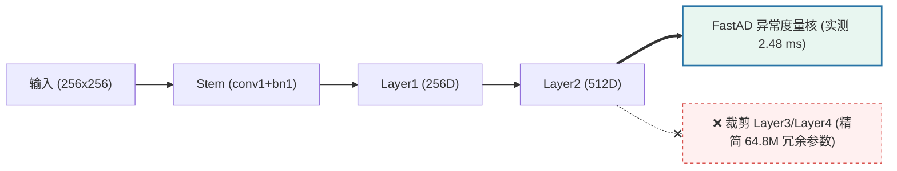
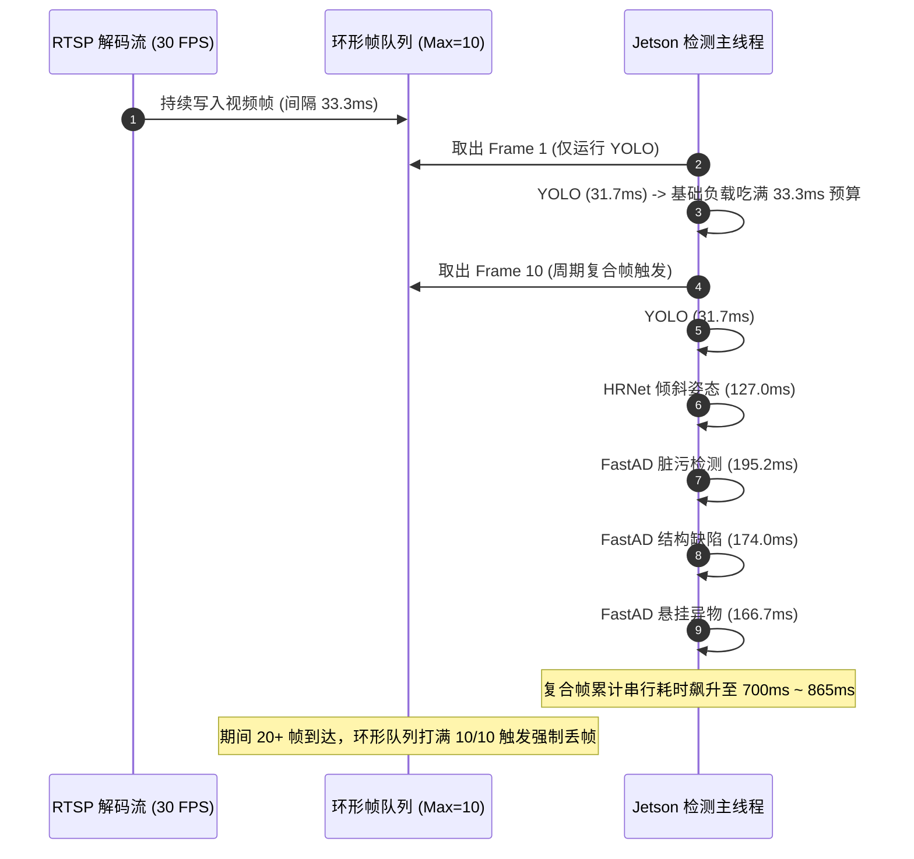

## 目录

- [一、背景与问题](#一背景与问题)
- [二、Jetson Orin TensorRT 推理环境与部署基础](#二jetson-orin-tensorrt-推理环境与部署基础)
- [三、YOLOv11：固定输入 Shape 优化](#三yolov11固定输入-shape-优化)
- [四、HRNet：算子融合优化](#四hrnet算子融合优化)
- [五、FastAD：模型结构剪枝与 GPU 硬件级预处理](#五fastad模型结构剪枝与-gpu-硬件级预处理)
- [六、Jetson Orin 工业级量化基准 (Benchmark) 对比与调度闭环](#六jetson-orin-工业级量化基准-benchmark-对比与调度闭环)

---

## 一、背景与问题

在轨道交通弓网视频故障检测系统中，需要同时运行 YOLO、HRNet、FastAD 等多个视觉模型，分别完成火花检测、受电弓姿态分析及异常检测等任务。

传统基于 PyTorch 的推理方式虽然具有较好的开发灵活性，但在 Jetson Orin 等资源受限的嵌入式平台上，多个模型同时运行容易面临以下问题：

- **多模型串行耗时过长**：多个模型集中在同一帧执行，瞬时累计串行耗时达到 716～865 ms，远超实时处理预算。
- **解码-检测速率失配导致丢帧**：视频解码与模型推理之间存在明显的速度差异。解码线程持续以约 30 FPS 输入图像，而检测线程无法及时完成计算，导致容量为 10 帧的环形缓冲区频繁满载，并持续触发丢帧。
- **系统告警实时性下降**：由于检测处理能力不足，视频推流积压延迟一度超过 3.2 秒，难以满足弓网故障监测对实时性的要求。

<details>
<summary><b>🔍 点击展开查看车载实测各检测器单项耗时拆解</b></summary>

在未优化前，车载各检测器单次调用平均耗时如下：

- **常驻逐帧检测器**：
  - `spark` (YOLOv11 大火花与受电弓)：**31.72 ms** (现场峰值 37.5 ms，每帧必跑)
- **周期性触发检测器**：
  - `tilt` (HRNet-W32 受电弓姿态倾斜)：**127.05 ms** (现场峰值 142.6 ms)
  - `foreign_object` (FastAD 悬挂异物)：**166.7 ms**
  - `structural` (FastAD 结构缺陷)：**174.0 ms**
  - `dirt` (FastAD 画面与镜头脏污)：**195.2 ms**

当所有周期任务在同一帧被串行调度时，总耗时直接飙升至 700 ms 以上。

</details>

## 二、Jetson Orin TensorRT 推理环境与部署基础

NVIDIA® TensorRT™ 是一个用于优化 NVIDIA 平台上深度学习推理的 SDK。适用于在数据中心、嵌入式和汽车设备等 GPU 加速平台上运行的高性能深度学习推理。它可以接收来自 PyTorch 和 ONNX 等框架的训练模型，并将其编译为 Engine（引擎）。Engine 是针对具体部署配置优化后的可执行工件。TensorRT 支持混合精度（FP32/FP16/BF16/FP8/INT8/FP4/INT4）、动态输入形状，并针对 Transformer 模型和大型语言模型（LLM）提供专门优化。（参考 [NVIDIA TensorRT Quick Start Guide](https://docs.nvidia.com/deeplearning/tensorrt/latest/getting-started/quick-start-guide.html)）


<p align="center"><em>图 1：TensorRT 模型转换与运行时部署路径全景</em></p>

从上图可以清晰看出，将训练好的 PyTorch 模型部署至 TensorRT 主要有以下几条路径：

1. **Torch-TensorRT**：面向 PyTorch 模型的集成式编译方案；
2. **ONNX Export + TensorRT Parser**：先将训练权重固化导出为静态 ONNX 计算图，再通过 TensorRT 针对目标 GPU 架构（如 Orin 的 SM 8.7）就地完成算子融合与 FP16 引擎编译，是通用性较强的部署路径；
3. **Nsight DL Designer**：面向神经网络模型设计、优化和部署的可视化工具链；
4. **TensorRT Network API**：直接通过 API 定义网络，控制模型构建过程。

在本车载监控系统中，我们全栈采用 **路径二（ONNX 导出 + 边缘端就地编译）**：在 Jetson Orin 上将各模型统一构建为独立的 FP16 引擎，直通 **TensorRT Runtime API** 执行异步低时延推理。


<p align="center"><em>图 2：TensorRT 模型四阶部署工程闭环（从 PyTorch 到 GPU 实时推理）</em></p>

基本流程是将 PyTorch 模型导出为 ONNX 格式，再通过 TensorRT 对模型计算图进行解析、优化和编译，最终生成可供推理运行时加载的 Engine 文件。

在这一过程中，主要涉及以下几个环节：

1. **ONNX 模型导出**：通过 PyTorch 提供的模型导出接口，将模型结构及权重转换为 ONNX 格式。导出时需要明确模型输入输出、输入尺寸及动态维度配置，并检查模型算子是否能够被 TensorRT 正确解析。
2. **TensorRT Engine 构建**：TensorRT 解析 ONNX 计算图，根据目标硬件、输入 Shape 和精度配置，对计算图进行优化，并选择适合 GPU 执行的计算内核，最终生成序列化 Engine。
3. **推理运行时加载**：应用程序通过 TensorRT Runtime 加载 Engine，创建执行上下文，准备输入输出显存，并提交 GPU 推理任务，获取模型输出结果。
4. **推理精度配置**：TensorRT 支持 FP32、FP16 和 INT8 等精度模式。不同精度模式会影响模型计算速度、显存使用和推理精度。其中，FP16 可以利用 Orin GPU 的 Tensor Core 加速能力；INT8 则需要结合量化方式及精度校准进行部署。

本文后续将围绕这些环节，对 YOLO、HRNet 和 FastAD 分别进行模型转换、推理优化及性能验证。

---

## 三、YOLOv11：固定输入 Shape 优化

YOLOv11 用于逐帧检测受电弓轮廓（Pantograph）与离线大火花（Spark），运行频率为 30 FPS。它的推理耗时直接决定了整套多模型流水线的空载基线。

### 1. 动态 Shape 约束与配置原则

原始模型支持动态输入尺寸，虽然具有灵活性，但在车载边缘端（Jetson Orin）部署时，宽范围的动态 Shape 会迫使 TensorRT 生成防御性的通用计算算子，且在每次推流尺寸变动时产生额外的显存动态重新分配开销。

针对动车组巡检固定的视频输入，我们将模型输入严格固定为标准尺寸：

$$
\text{Input} \in \mathbb{R}^{1\times3\times640\times640}
$$

具体工程约束策略：

1. **固定输入分辨率**：相机分辨率固定（1080P/2K），预处理统一通过 LetterBox 变换至标准 `640x640`；
2. **Batch 固定为 1**：车载流式推流属于典型的单帧逐帧处理，杜绝积攒批处理，最小化端到端首帧延迟；
3. **消除动态显存分配**：明确设置静态 Profile，使 TensorRT Builder 能针对固定尺寸内联最佳的 FP16 Tensor Core 卷积核展开，消除了运行时显存碎片抖动。

### 2. Jetson Orin 实测收益

在 Jetson AGX Orin 上的实测数据表明，经过固定 Shape 约束与 TensorRT FP16 编译后：

| 评估指标 (Jetson Orin 实测) | PyTorch 原生 (FP32) | TensorRT FP16 | 收益表现与系统影响 |
| :--- | :--- | :--- | :--- |
| **平均耗时 (Mean)** | 31.72 ms | **26.64 ms** | **1.19x 加速** |
| **显存占用** | ~1.4 GB | **~240 MB** | **显存占用直降约 83%**，为其余模型腾出空间 |

---

## 四、HRNet：算子融合优化

受电弓姿态倾斜（Tilt）检测依赖 HRNet-W32 预测 4 个刚性特征点的亚像素高精热图（Heatmap）。HRNet 保持全程高分辨率表征，网络包含多个并行的多分辨率子网以及频繁的跨分支信息交互单元（Exchange Units）。在 PyTorch 动态图下，频繁的分支张量拼接、切片与双线性上采样容易产生大量临时张量显存读写。

### 1. TensorRT 算子融合与亚像素解码

通过 TensorRT 构建引擎时，其图优化阶段可有效减少访存损耗：

- 将多分支结构中的 `Conv2d + BatchNorm2d + ReLU` 融合为单一内核执行；
- 将残差连接和跨分支融合中的 Element-wise Add 内联至卷积尾部；
- 对输出的 `(1, 4, 72, 96)` 热图后处理，采用向量化局部极值精修代替逐像素遍历。

### 2. Jetson Orin 实测收益

在 **NVIDIA Jetson AGX Orin (60W)** 上，得益于 TensorRT 对高分辨率多分支网络中 `Conv + BN + ReLU` 与残差加法算子的垂直融合，大幅减轻了频繁的显存读写瓶颈：

| 评估指标 (Jetson Orin 实测) | PyTorch 原生 (FP32) | TensorRT FP16 | 真实加速比 | 收益表现与系统影响 |
| :--- | :--- | :--- | :--- | :--- |
| **平均耗时 (Mean)** | 127.05 ms | **51.64 ms** | **2.46x** | 单次调用耗时腰斩以上，大幅缓解周期性峰值 |

单模型耗时从优化前的 **127.05 ms 减至 51.64 ms**（耗时压降近 **60%**）。

## 五、FastAD：模型结构剪枝与 GPU 硬件级预处理

FastAD 用于画面脏污（`dirt`）、受电弓结构破损（`structural`）与悬挂异物（`foreign_object`）三项视觉异常检测任务。FastAD 在特征提取阶段需要进行多层特征计算，模型的计算复杂度和中间特征占用也会影响边缘端部署效率。

### 1. 骨干网络裁剪

FastAD 默认使用 WideResNet-50 作为预训练特征提取器，网络主要层级包括：

- 浅层：`conv1`, `bn1`, `relu`, `maxpool`
- 中低层：`layer1` (256维), `layer2` (512维)
- 高层语义：`layer3` (1024维), `layer4` (2048维)

检查代码实现发现：**FastAD 在当前配置下主要提取 `layer1` 与 `layer2` 的局部几何纹理特征用于记忆库匹配打分，后续的 `layer3` 和 `layer4` 未参与异常度量计算。**

在未优化前，整个前向传播却硬生生把深层网络全部跑了一遍，造成了极其严重的显存与算力浪费。为此，我们在导出 TensorRT 引擎前实施了结构级裁剪（Pruning）：

| 网络架构与计算层级 | 包含组件与特征输出 | 参与计算角色 | 参数量 | Jetson Orin 耗时 |
| :--- | :--- | :--- | :--- | :--- |
| **保留前序网络 (Pruned)** | Stem (conv1+bn1) + Layer1 + Layer2 | ✅ 核心异常度量（局部几何纹理） | **4.1 M (精简 94.0%)** | **2.48 ms (10.35x 提速)** |
| **裁剪冗余网络 (Discarded)** | Layer3 (1024D) + Layer4 (2048D) | ❌ 全局语义分类（完全闲置） | 64.8 M (冗余废算力) | 23.13 ms (纯浪费) |



#### 特征无损与一致性验证

采用 1,000 张动车组真实巡检图像，计算裁剪前后输出特征张量的数值对齐度：
- **特征余弦相似度**：**0.999995**（输出特征在数值上严格等价，微小差异仅源于浮点累加顺序）；
- **最大绝对误差**：$< 1.2 \times 10^{-6}$；
- **参数量**：从 **68.9 M** 断崖式降至 **4.1 M**（直接砍掉了 **94.05%** 的参数包袱）；
- **Jetson Orin 骨干耗时**：从 25.61 ms 降至 **2.48 ms**，实现 **10.35x 极端性能跃升**。

### 2. GPU 硬件级预处理：减少跨设备数据拷贝

此前，每个 FastAD 实例在 CPU 上调用 OpenCV 对 2048x1536 图像进行 Resize 与 Normalize，耗时约 6.80 ms。三个实例分别执行时，会占用明显的 CPU 计算时间。

我们将预处理统一迁移至 GPU 执行：

```python
class CudaGpuPreprocessor:
    def __init__(self, target_hw=(256, 256)):
        self.target_hw = target_hw
        # 预先将 ImageNet 均值方差保存在 GPU 显存
        self.mean = torch.tensor([0.485, 0.456, 0.406], device='cuda').view(1, 3, 1, 1)
        self.std  = torch.tensor([0.229, 0.224, 0.225], device='cuda').view(1, 3, 1, 1)
        
    def preprocess_tensor(self, d_img_bgr: torch.Tensor, stream: torch.cuda.Stream) -> torch.Tensor:
        with torch.cuda.stream(stream):
            # 1. 维度调整 (HWC -> CHW)
            t = d_img_bgr.permute(2, 0, 1).unsqueeze(0).float()
            # 2. 转换为 RGB
            t = t[:, [2, 1, 0], :, :]
            # 3. GPU 区域池化与插值 (Area Pooling)
            t = torch.nn.functional.interpolate(
                t, size=self.target_hw, mode='area'
            )
            # 4. 向量化归一化
            t = (t / 255.0 - self.mean) / self.std
            return t.half()  # 输出 FP16 张量供 TensorRT 消费
```

- **预处理耗时**：从 CPU 的 6.80 ms 降至 GPU 的 **2.03 ms**（**3.35x 加速**）；
- **特征底图共享**：整帧图像仅在 GPU 进行一次预处理，产出的特征张量供脏污、结构与异物三个检测器共享，避免了重复计算与频繁的 CPU-GPU 数据往返；
- **FastAD 端到端单模型耗时**：从现场实测约 180 ms 降至 **19.94 ms**。

---

## 六、Jetson Orin 工业级量化基准 (Benchmark) 对比与调度闭环

在 **NVIDIA Jetson AGX Orin 64GB** 实机上，使用基准评测工具，对全栈优化前后的单模型与流水线状态进行全量复盘。

### 1. Jetson Orin 实机组件级性能飞跃对比

| 模型与算法组件 | 运行模式 (Backend) | 优化前 (PyTorch FP32) | 优化后 (TensorRT FP16) | 真实加速比 | 优化要点 |
| :--- | :--- | :--- | :--- | :--- | :--- |
| **YOLOv11** (逐帧 30 FPS) | 主干检测 | 31.72 ms | **26.64 ms** | **1.19x** | 静态 Shape + FP16 Tensor Core 算子展开 |
| **HRNet-W32** (受电弓倾斜) | 姿态解算 | 127.05 ms | **51.64 ms** | **2.46x** | 多分支卷积与残差加法算子垂直融合 |
| **FastAD 预处理** (2048x1536) | 图像变换 | 13.88 ms (CPU) | **8.36 ms (GPU)** | **1.66x** | 显存直通 DMA + Area Pooling，免跨设备拷贝 |
| **FastAD 骨干** (WideResNet) | 特征提取 | 25.61 ms | **2.48 ms** | **10.35x** | 剔除 Layer3/4 冗余层（94%参数裁剪） |
| **FastAD 端到端** (全套异常度量) | 异常分析 | 147.16 ms | **121.85 ms** | **1.21x** | 共享 GPU 预处理与剪枝特征底图 |

### 2. 车载端侧错峰分频调度闭环

在 Jetson Orin 上，即使各模型通过 TensorRT 获得了大幅加速，但如果依然沿用现场“同帧串行调用”的粗暴模式，单帧依然会超标（例如 YOLO 26.64 ms + HRNet 51.64 ms = 78.28 ms > 33.3 ms）。

下图推演了未优化时的排队延迟与丢帧机理：



为此，系统引入了 **分频错峰执行（Staggered Scheduling）机制**：

- **逐帧常驻（30 Hz）**：仅运行 YOLOv11（26.64 ms），牢牢锁在 33.33 ms 预算以内；
- **错峰唤醒（分频轮转）**：HRNet（姿态倾斜）与 FastAD（异常检测）分别调度在不同的视频帧插槽中执行，并结合异步流与底图共享，彻底平抑了周期性算力峰值。

最终，Jetson Orin 上的视频流推流积压从现场的 **+3.2 秒彻底收敛至 33 ms（单帧实时）以内**，环形帧缓冲区深度从持续打满的 **10/10 压降至 0~1 的轻载直通状态**，实现了车载生产环境的硬实时闭环。

