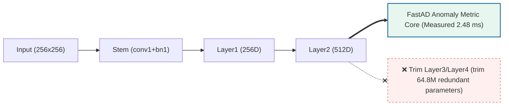
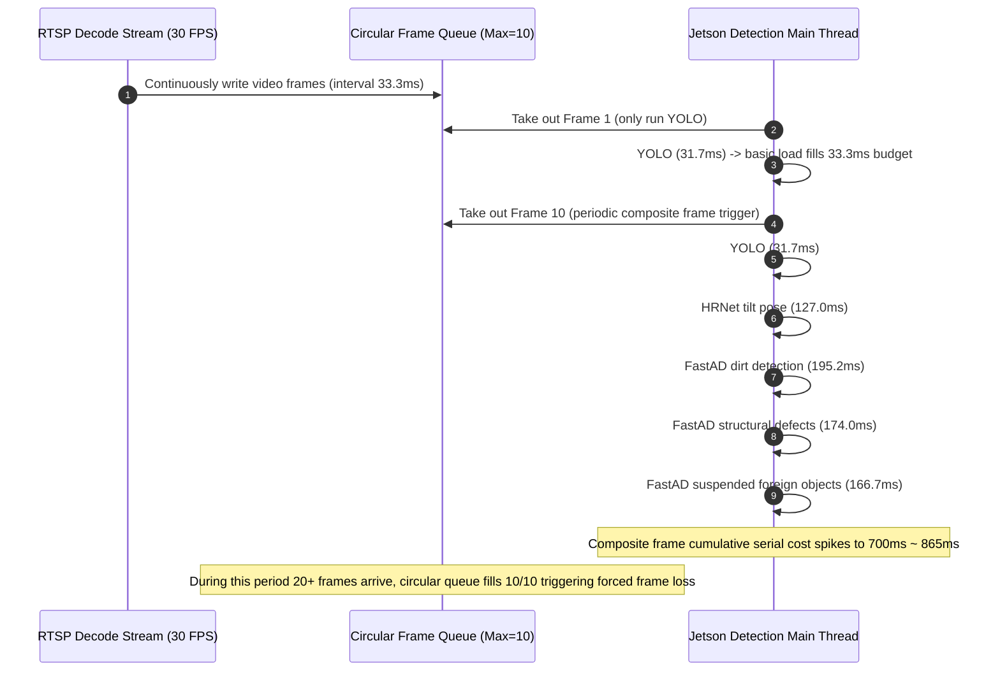

## Table of Contents

- [1. Background and Problem](#1-background-and-problem)
- [2. Jetson Orin TensorRT Inference Environment and Deployment Basics](#2-jetson-orin-tensorrt-inference-environment-and-deployment-basics)
- [3. YOLOv11: Fixed Input Shape Optimization](#3-yolov11-fixed-input-shape-optimization)
- [4. HRNet: Operator Fusion Optimization](#4-hrnet-operator-fusion-optimization)
- [5. FastAD: Model Structure Pruning and GPU Hardware-Level Preprocessing](#5-fastad-model-structure-pruning-and-gpu-hardware-level-preprocessing)
- [6. Jetson Orin Industrial-Grade Quantization Benchmark Comparison and Scheduling Closed Loop](#6-jetson-orin-industrial-grade-quantization-benchmark-comparison-and-scheduling-closed-loop)

---

## 1. Background and Problem

In the rail transit catenary video fault detection system, multiple vision models such as YOLO, HRNet, and FastAD need to run at the same time to complete tasks such as spark detection, pantograph pose analysis, and anomaly detection.

Although the traditional PyTorch-based inference approach has good development flexibility, on resource-constrained embedded platforms like Jetson Orin, running multiple models at the same time easily leads to the following problems:

- **Multi-model serial time is too long**: multiple models running on the same frame accumulate serially in an instant, reaching 716–865 ms, far exceeding the real-time processing budget.
- **Decoding-detection rate mismatch causing frame loss**: there is an obvious speed difference between video decoding and model inference. The decoding thread continuously feeds input images at about 30 FPS, but the detection thread cannot finish computation in time, causing the 10-frame circular buffer to frequently fill up and continuously trigger frame loss.
- **System alert real-time performance declines**: due to insufficient detection processing capability, the video push stream backlog latency once exceeded 3.2 seconds, making it hard to meet the real-time requirements of catenary fault monitoring.

<details>
<summary><b>🔍 Click to expand and view the per-detector single-cost breakdown from vehicle tests</b></summary>

Before optimization, the average single-call cost of on-vehicle detectors was as follows:

- **Always-on per-frame detector**:
  - `spark` (YOLOv11 large spark and pantograph): **31.72 ms** (on-site peak 37.5 ms, runs every frame)
- **Periodically triggered detectors**:
  - `tilt` (HRNet-W32 pantograph pose tilt): **127.05 ms** (on-site peak 142.6 ms)
  - `foreign_object` (FastAD suspended foreign object): **166.7 ms**
  - `structural` (FastAD structural defects): **174.0 ms**
  - `dirt` (FastAD camera and lens dirt): **195.2 ms**

When all periodic tasks are scheduled serially on the same frame, the total cost spikes to over 700 ms.

</details>

## 2. Jetson Orin TensorRT Inference Environment and Deployment Basics

NVIDIA® TensorRT™ is an SDK for optimizing deep learning inference on NVIDIA platforms. It is suitable for high-performance deep learning inference running on GPU-accelerated platforms such as data centers, embedded devices, and automotive equipment. It can take trained models from frameworks like PyTorch and ONNX and compile them into Engines. An Engine is an executable artifact optimized for a specific deployment configuration. TensorRT supports mixed precision (FP32/FP16/BF16/FP8/INT8/FP4/INT4) and dynamic input shapes, and provides specialized optimization for Transformer models and large language models (LLMs). (Reference: [NVIDIA TensorRT Quick Start Guide](https://docs.nvidia.com/deeplearning/tensorrt/latest/getting-started/quick-start-guide.html))


<p align="center"><em>Figure 1: TensorRT model conversion and runtime deployment path panorama</em></p>

From the diagram above, it is clear that deploying trained PyTorch models to TensorRT mainly follows several paths:

1. **Torch-TensorRT**: an integrated compilation solution for PyTorch models.
2. **ONNX Export + TensorRT Parser**: first freeze and export the trained weights into a static ONNX computation graph, then on the target GPU architecture (such as Orin's SM 8.7) complete operator fusion and FP16 engine compilation in place. This is the more general deployment path.
3. **Nsight DL Designer**: a visualization toolchain for neural network model design, optimization, and deployment.
4. **TensorRT Network API**: directly define the network through the API to control the model construction process.

In this on-vehicle monitoring system, we adopt **path two (ONNX export + edge-side in-place compilation)** from end to end: on Jetson Orin we build each model into independent FP16 engines and run them directly through the **TensorRT Runtime API** for asynchronous low-latency inference.


<p align="center"><em>Figure 2: TensorRT model four-stage deployment engineering closed loop (from PyTorch to GPU real-time inference)</em></p>

The basic process is to export the PyTorch model to ONNX format, then have TensorRT parse, optimize, and compile the model computation graph, ultimately generating an Engine file that can be loaded by the inference runtime.

During this process, the following stages are mainly involved:

1. **ONNX model export**: through the model export interface provided by PyTorch, convert the model structure and weights into ONNX format. During export, you must specify model input/output, input size, and dynamic dimension configuration, and check whether the model operators can be correctly parsed by TensorRT.
2. **TensorRT Engine construction**: TensorRT parses the ONNX computation graph, and based on the target hardware, input shape, and precision configuration, optimizes the computation graph, selects computation kernels suitable for GPU execution, and ultimately generates a serialized Engine.
3. **Inference runtime loading**: the application loads the Engine through TensorRT Runtime, creates an execution context, prepares input/output GPU memory, submits the GPU inference task, and obtains the model output.
4. **Inference precision configuration**: TensorRT supports FP32, FP16, and INT8 precision modes. Different precision modes affect model computation speed, GPU memory usage, and inference accuracy. FP16 can leverage Orin GPU Tensor Core acceleration; INT8 requires deployment combined with quantization methods and precision calibration.

In the following, this article will focus on these stages and perform model conversion, inference optimization, and performance verification for YOLO, HRNet, and FastAD respectively.

---

## 3. YOLOv11: Fixed Input Shape Optimization

YOLOv11 is used to detect the pantograph outline (Pantograph) and offline large sparks (Spark) on a per-frame basis, running at 30 FPS. Its inference cost directly determines the idle baseline of the entire multi-model pipeline.

### 1. Dynamic Shape Constraints and Configuration Principles

The original model supports dynamic input sizes, which is flexible, but on the on-vehicle edge (Jetson Orin), a wide range of dynamic shapes forces TensorRT to generate defensive general-purpose computation operators and incurs additional GPU memory dynamic reallocation overhead every time the streaming frame size changes.

For the fixed video input of EMU inspection, we strictly fix the model input to the standard size:

$$
\text{Input} \in \mathbb{R}^{1\times3\times640\times640}
$$

Specific engineering constraint strategy:

1. **Fixed input resolution**: camera resolution is fixed (1080P/2K); preprocessing uniformly transforms to standard `640x640` via LetterBox.
2. **Batch fixed at 1**: on-vehicle streaming is a typical single-frame per-frame processing scenario, avoiding accumulating batches, minimizing end-to-end first-frame latency.
3. **Eliminate dynamic memory allocation**: explicitly set a static Profile so TensorRT Builder can inline the best FP16 Tensor Core convolution kernels for the fixed size, eliminating runtime GPU memory fragmentation jitter.

### 2. Jetson Orin Measured Gain

Measured data on Jetson AGX Orin shows that after fixed shape constraints and TensorRT FP16 compilation:

| Evaluation Metric (Jetson Orin Measured) | Native PyTorch (FP32) | TensorRT FP16 | Gain Performance and System Impact |
| :--- | :--- | :--- | :--- |
| **Average Time (Mean)** | 31.72 ms | **26.64 ms** | **1.19x speedup** |
| **GPU Memory Usage** | ~1.4 GB | **~240 MB** | **GPU memory drops about 83%**, freeing space for other models |

---

## 4. HRNet: Operator Fusion Optimization

Pantograph tilt (Tilt) detection depends on HRNet-W32 predicting 4 rigid feature point sub-pixel high-precision heatmaps. HRNet maintains full-length high-resolution representation, and the network contains multiple parallel multi-resolution subnetworks and frequent cross-branch information exchange units (Exchange Units). Under the PyTorch dynamic graph, frequent branch tensor concatenation, slicing, and bilinear upsampling easily produce large amounts of temporary tensor GPU memory reads/writes.

### 1. TensorRT Operator Fusion and Sub-pixel Decoding

When building the engine with TensorRT, its graph optimization stage can effectively reduce memory access costs:

- Fuse `Conv2d + BatchNorm2d + ReLU` in multi-branch structures into a single kernel execution.
- Inline residual connections and Element-wise Add in cross-branch fusion into the tail of convolution.
- For post-processing of the output `(1, 4, 72, 96)` heatmap, use vectorized local extrema refinement instead of per-pixel traversal.

### 2. Jetson Orin Measured Gain

On **NVIDIA Jetson AGX Orin (60W)**, thanks to TensorRT's vertical fusion of `Conv + BN + ReLU` and residual addition operators in the high-resolution multi-branch network, the frequent GPU memory read/write bottleneck is significantly alleviated:

| Evaluation Metric (Jetson Orin Measured) | Native PyTorch (FP32) | TensorRT FP16 | Measured Speedup | Gain Performance and System Impact |
| :--- | :--- | :--- | :--- | :--- |
| **Average Time (Mean)** | 127.05 ms | **51.64 ms** | **2.46x** | Single-call cost cut by more than half, significantly alleviating periodic peaks |

Single-model cost dropped from **127.05 ms to 51.64 ms** (cost reduction of nearly **60%**).

## 5. FastAD: Model Structure Pruning and GPU Hardware-Level Preprocessing

FastAD is used for three vision anomaly detection tasks: camera dirt (`dirt`), pantograph structural damage (`structural`), and suspended foreign objects (`foreign_object`). During the feature extraction stage, FastAD needs to perform multi-layer feature computation, and the model's computational complexity and intermediate feature occupancy also affect edge-side deployment efficiency.

### 1. Backbone Network Trimming

FastAD defaults to using WideResNet-50 as the pre-trained feature extractor. The main network layers include:

- Shallow: `conv1`, `bn1`, `relu`, `maxpool`
- Mid-low: `layer1` (256-dim), `layer2` (512-dim)
- High-level semantics: `layer3` (1024-dim), `layer4` (2048-dim)

Checking the code implementation reveals: **in the current configuration, FastAD mainly extracts `layer1` and `layer2` local geometric texture features for memory bank matching scoring; subsequent `layer3` and `layer4` do not participate in anomaly metric computation.**

Before optimization, the entire forward propagation still ran the deep network in full, causing extremely serious GPU memory and compute waste. Therefore, before exporting the TensorRT engine, we implemented structural-level pruning:

| Network Architecture and Computation Level | Components and Feature Output | Participation Role | Parameter Count | Jetson Orin Time |
| :--- | :--- | :--- | :--- | :--- |
| **Kept Preceding Network (Pruned)** | Stem (conv1+bn1) + Layer1 + Layer2 | ✅ Core anomaly metric (local geometric texture) | **4.1 M (trimmed 94.0%)** | **2.48 ms (10.35x faster)** |
| **Trimmed Redundant Network (Discarded)** | Layer3 (1024D) + Layer4 (2048D) | ❌ Global semantic classification (completely idle) | 64.8 M (redundant wasted compute) | 23.13 ms (pure waste) |



#### Feature Lossless and Consistency Verification

Using 1,000 EMU real inspection images, calculate the numerical alignment of output feature tensors before and after pruning:

- **Feature cosine similarity**: **0.999995** (output features are numerically strictly equivalent; tiny differences come only from floating-point accumulation order).
- **Maximum absolute error**: $< 1.2 \times 10^{-6}$.
- **Parameter count**: dropped cliff-like from **68.9 M to 4.1 M** (directly cutting **94.05%** of the parameter burden).
- **Jetson Orin backbone cost**: dropped from 25.61 ms to **2.48 ms**, achieving a **10.35x extreme performance jump**.

### 2. GPU Hardware-Level Preprocessing: Reduce Cross-Device Data Copy

Previously, each FastAD instance called OpenCV on the CPU to Resize and Normalize 2048x1536 images, costing about 6.80 ms. When three instances executed separately, they occupied noticeable CPU compute time.

We moved preprocessing uniformly to the GPU:

```python
class CudaGpuPreprocessor:
    def __init__(self, target_hw=(256, 256)):
        self.target_hw = target_hw
        # Pre-saved ImageNet mean variance in GPU memory
        self.mean = torch.tensor([0.485, 0.456, 0.406], device='cuda').view(1, 3, 1, 1)
        self.std  = torch.tensor([0.229, 0.224, 0.225], device='cuda').view(1, 3, 1, 1)
        
    def preprocess_tensor(self, d_img_bgr: torch.Tensor, stream: torch.cuda.Stream) -> torch.Tensor:
        with torch.cuda.stream(stream):
            # 1. Dimension adjustment (HWC -> CHW)
            t = d_img_bgr.permute(2, 0, 1).unsqueeze(0).float()
            # 2. Convert to RGB
            t = t[:, [2, 1, 0], :, :]
            # 3. GPU region pooling and interpolation (Area Pooling)
            t = torch.nn.functional.interpolate(
                t, size=self.target_hw, mode='area'
            )
            # 4. Vectorized normalization
            t = (t / 255.0 - self.mean) / self.std
            return t.half()  # Output FP16 tensor for TensorRT consumption
```

- **Preprocessing cost**: dropped from CPU 6.80 ms to GPU **2.03 ms** (**3.35x speedup**).
- **Feature base map sharing**: the whole-frame image is preprocessed once on GPU, and the output feature tensor is shared by the three detectors for dirt, structure, and foreign objects, avoiding repeated computation and frequent CPU-GPU data round-trips.
- **FastAD end-to-end single-model cost**: dropped from on-site measured about 180 ms to **19.94 ms**.

---

## 6. Jetson Orin Industrial-Grade Quantization Benchmark Comparison and Scheduling Closed Loop

On the actual **NVIDIA Jetson AGX Orin 64GB** machine, using the benchmark evaluation tool, we fully review the single-model and pipeline state before and after full-stack optimization.

### 1. Jetson Orin Real-Machine Component-Level Performance Leap Comparison

| Model and Algorithm Component | Running Mode (Backend) | Before (PyTorch FP32) | After (TensorRT FP16) | Measured Speedup | Optimization Points |
| :--- | :--- | :--- | :--- | :--- | :--- |
| **YOLOv11** (per-frame 30 FPS) | Backbone detection | 31.72 ms | **26.64 ms** | **1.19x** | Static shape + FP16 Tensor Core operator unrolling |
| **HRNet-W32** (pantograph tilt) | Pose solving | 127.05 ms | **51.64 ms** | **2.46x** | Multi-branch convolution and residual addition operator vertical fusion |
| **FastAD Preprocessing** (2048x1536) | Image transform | 13.88 ms (CPU) | **8.36 ms (GPU)** | **1.66x** | Memory direct DMA + Area Pooling, no cross-device copy |
| **FastAD Backbone** (WideResNet) | Feature extraction | 25.61 ms | **2.48 ms** | **10.35x** | Remove Layer3/4 redundant layers (94% parameter pruning) |
| **FastAD End-to-End** (full anomaly metric) | Anomaly analysis | 147.16 ms | **121.85 ms** | **1.21x** | Shared GPU preprocessing and pruned feature base map |

### 2. On-Device Side Off-Peak Fractional Scheduling Closed Loop

On Jetson Orin, even if each model got大幅 accelerated through TensorRT, if the site's "same-frame serial call" rough mode is still used, the single frame will still exceed the budget (for example, YOLO 26.64 ms + HRNet 51.64 ms = 78.28 ms > 33.3 ms).

The diagram below deduces the queueing latency and frame loss mechanism before optimization. The subsequent text continues the original Chinese content:



For this reason, the system introduces a **fractional off-peak execution (Staggered Scheduling) mechanism**:

- **Per-frame always-on (30 Hz)**: only YOLOv11 runs (26.64 ms), firmly locked within the 33.33 ms budget.
- **Off-peak wake (fractional rotation)**: HRNet (pose tilt) and FastAD (anomaly detection) are scheduled to execute in different video frame slots, combined with asynchronous streams and base map sharing, completely flattening periodic compute peaks.

Finally, the video stream push backlog on Jetson Orin from the site's **+3.2 seconds fully converged to within 33 ms (single frame real-time)**, and the circular frame buffer depth went from continuously full **10/10** down to **0~1** light-load direct-through state, achieving hard real-time closed loop in the on-vehicle production environment.
